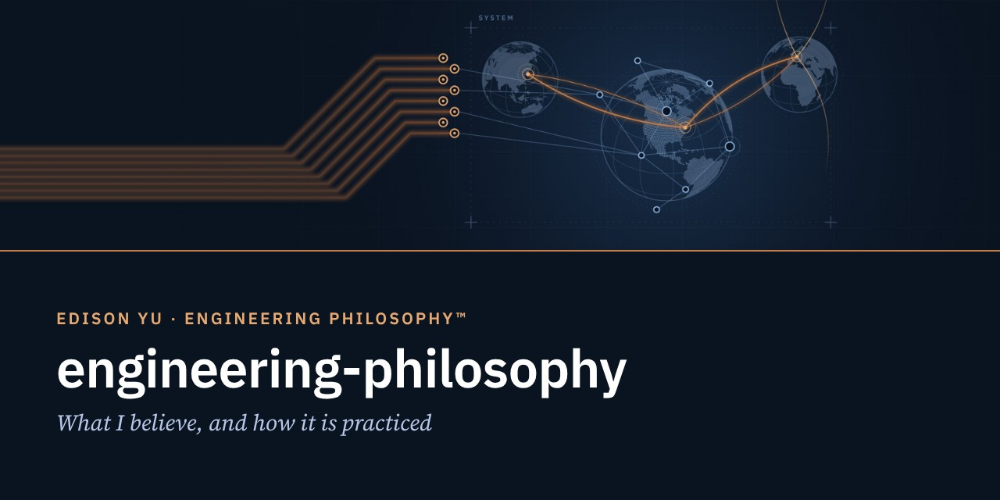
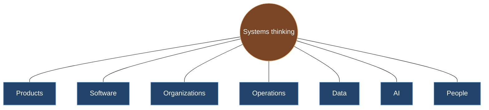

  

# Engineering Philosophy™

**What I believe, and how it is practiced.**
Principles · Essays · Perspectives · Systems Thinking

> Technology has been the medium.
> Integration has been the journey.
> Human intention, trust, and connection remain the destination.

---

## Purpose

**Why it exists.** Engineering Philosophy™ is the canonical collection of engineering principles, systems-thinking perspectives, leadership lessons, integration concepts, and technology philosophy developed through Edison Yu's career. This repository is its engineering-facing home on GitHub.

**What problem it solves.** Principles stated without their origin read like slogans. Each principle here is tied to the work that produced it, so a reader can judge it by the experience behind it.

**How it fits the ecosystem.** Engineering Philosophy™ defines the principles. [Leadership™](https://www.yugeniuslab.com/leadership/) defines the practice. The full document lives at [yugeniuslab.com/engineering-philosopher](https://www.yugeniuslab.com/engineering-philosopher/).

## Identity

Throughout my career, the scale changed. The principles did not.

An evolution of perspective, not a title.

## Architecture: the principles

### Core principles
The three conclusions everything else depends on.

1. **An idea counts only once it is implemented.**
2. **Most failures emerge at boundaries.**
3. **Connection without trust becomes risk.**

### Supporting principles
How the core principles show up in operations, decisions, and the field.

4. **A company is a system, and it fails at the interfaces.**
5. **A delayed decision is still a decision.**
6. **Technology must serve reality.**

### In practice
How the principles are carried into daily work, in engineering and beyond it.

- **Architecture before implementation.** Before writing code, the system must be understood. Before optimization, structure must be correct. Before selecting technology, the problem must be clearly defined.
- **Documentation before development.**
- **Systems, people, technology, and organizations follow the same architecture.**
- **AI assists. Human intention remains the source.**
- **Engineering is not limited to working hours. It is a lifelong discipline.**

### Systems thinking

Clarity over complexity. Architecture over improvisation. Long-term thinking over short-term optimization. Trust through consistency. Simplicity through understanding.

## Relationship to GOE

Engineering Philosophy is the eighth level of the [GOE Operating System™](https://www.yugeniuslab.com/publications/goe-operating-system/) framework.

## Relationship to Yu Genius Lab

Yu Genius Lab publishes knowledge. Engineering Philosophy™ is one of its four foundational documents, beside Executive Profile™, Biography™, and Leadership™.

## Repository layout

| Folder | Contents |
|---|---|
| `principles/` | One page per principle: the principle, where it was learned, how it is practiced |
| `essays/` | Essays on engineering, leadership, systems thinking, and AI-assisted engineering |
| `perspectives/` | Short commentaries and framework maps |

## Vocabulary

| Term | Definition |
|---|---|
| Engineering Philosophy™ | The canonical collection of engineering principles, systems-thinking perspectives, leadership lessons, integration concepts, and technology philosophy developed through Edison Yu's career |
| Leadership™ | The practical application of Engineering Philosophy™ through people, organizations, execution, and trusted connection |
| Systems thinking | Treating products, software, organizations, operations, data, AI, and people as connected systems |

## Future Direction

New essays and principle pages are published on the website first and added here after each website revision.

## References

- [Engineering Philosophy™](https://www.yugeniuslab.com/engineering-philosopher/) · [Leadership™](https://www.yugeniuslab.com/leadership/) · [Biography™](https://www.yugeniuslab.com/biography/)
- [Open Knowledge™](https://www.yugeniuslab.com/open-knowledge/)

---

© 2026 Edison Yu. All rights reserved. You may read, link to, and quote short excerpts with attribution. · Engineering Repository™ · Revision 2026.70
